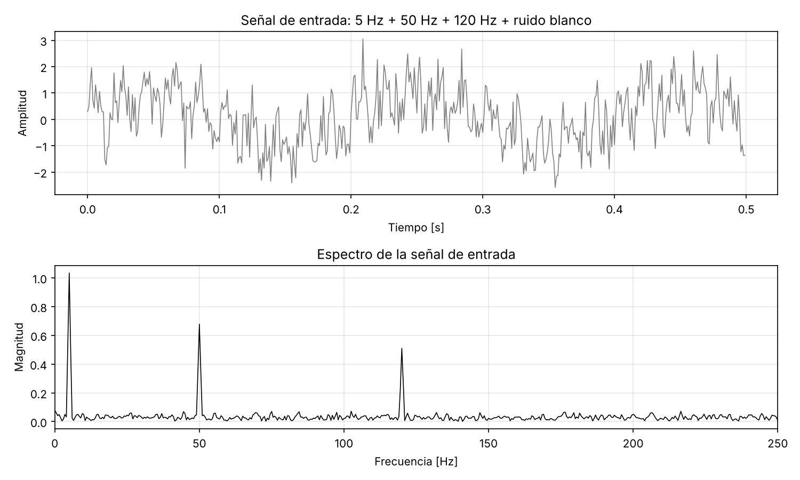
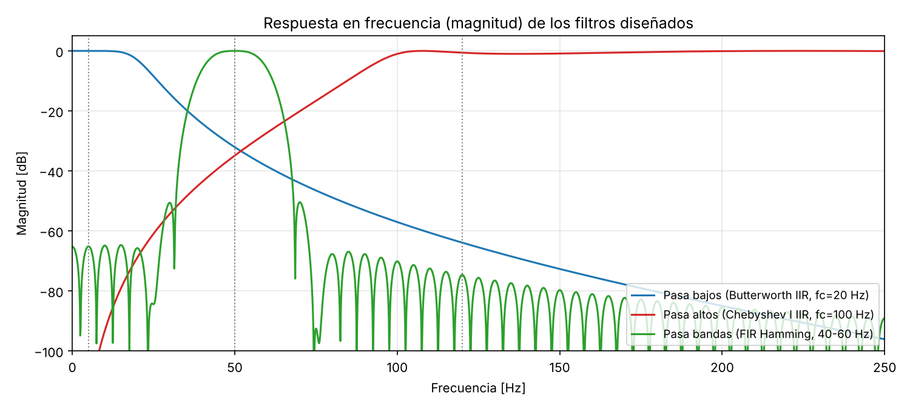
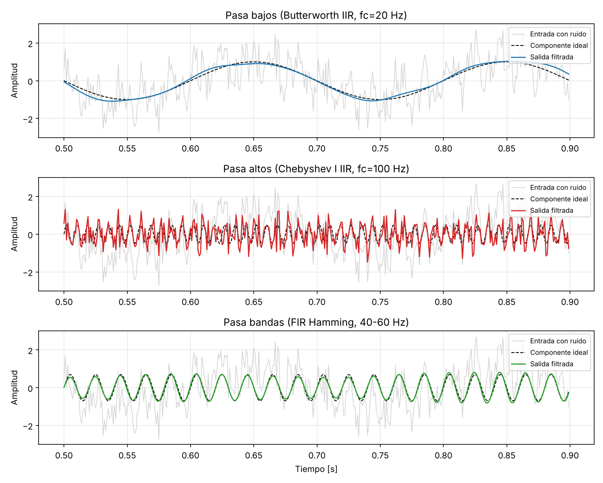
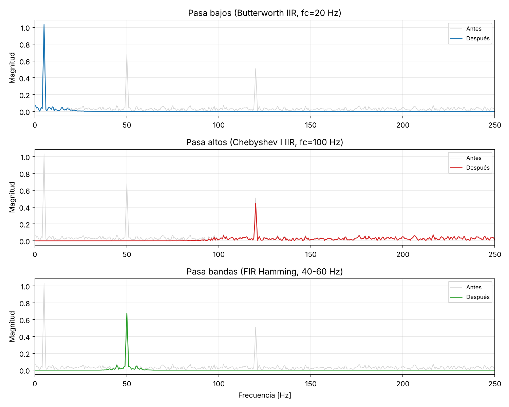
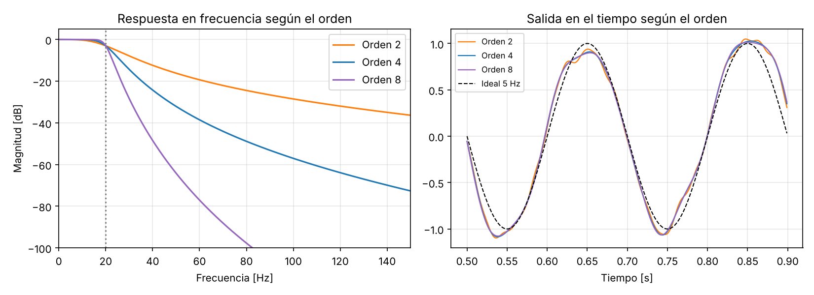

# Filtros digitales: pasa bajos, pasa altos y pasa bandas en Python

Actividad formativa 3 de la materia **Señales y Sistemas**
Universidad Ciudadana de Nuevo León · Ingeniería en Desarrollo de Software
Alumno: Mario Alberto Zavala González · Tutor: Ing. Luis Osvaldo Moreno Gaytán

## Propósito

Diseñar, aplicar y evaluar tres filtros digitales sobre una señal con ruido:

| Filtro | Tipo | Método | Configuración | Componente que conserva |
|---|---|---|---|---|
| Pasa bajos | IIR | Butterworth | Orden 4, fc = 20 Hz | 5 Hz |
| Pasa altos | IIR | Chebyshev tipo I | Orden 4, rizo 1 dB, fc = 100 Hz | 120 Hz |
| Pasa bandas | FIR | Ventana Hamming | 201 coeficientes, 40–60 Hz | 50 Hz |

La señal de prueba es la suma de senoidales de 5 Hz, 50 Hz y 120 Hz más ruido blanco gaussiano, muestreada a 1000 Hz durante 2 segundos.

## Estructura del código

El script `filtros_digitales.py` está dividido en secciones comentadas:

1. Definición de la señal de entrada
2. Diseño de los filtros
3. Aplicación de los filtros a la señal (`filtfilt`, sin desfase)
4. Visualización de resultados (tiempo y frecuencia)
5. Métricas de efectividad (ganancia en dB y SNR)
6. Comparación de configuraciones (orden 2, 4 y 8 del Butterworth)

## Cómo ejecutarlo

```bash
pip install -r requirements.txt
python filtros_digitales.py
```

Las gráficas se guardan en `figuras/` y las métricas en `resultados.csv`.

## Resultados principales

| Filtro | SNR antes | SNR después | Mejora |
|---|---|---|---|
| Pasa bajos Butterworth | -1.6 dB | 15.6 dB | +17.1 dB |
| Pasa altos Chebyshev I | -9.5 dB | -2.6 dB | +6.9 dB |
| Pasa bandas FIR Hamming | -6.2 dB | 14.4 dB | +20.6 dB |

El pasa altos mejora menos porque deja pasar todo el ruido entre 100 y 500 Hz. El ruido blanco tiene energía en todas las frecuencias, así que un filtro con banda de paso ancha conserva más ruido.

## Gráficas







## Requisitos

- Python 3.9 o superior
- NumPy, SciPy y Matplotlib (ver `requirements.txt`)
